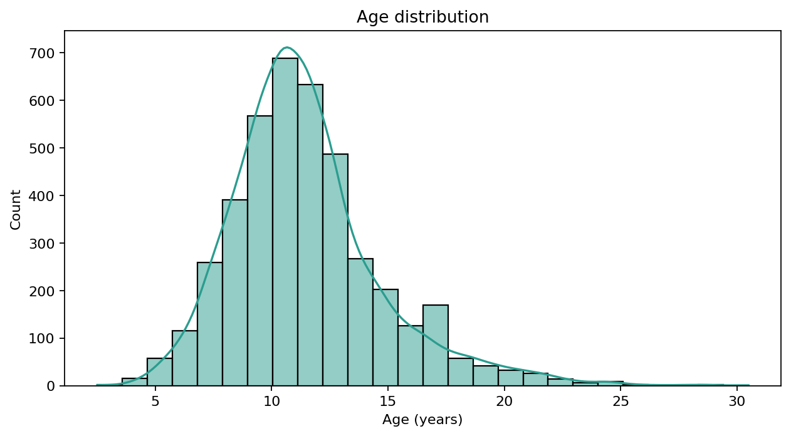
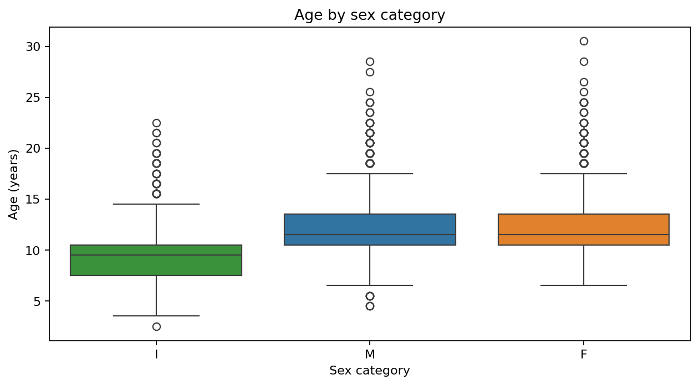
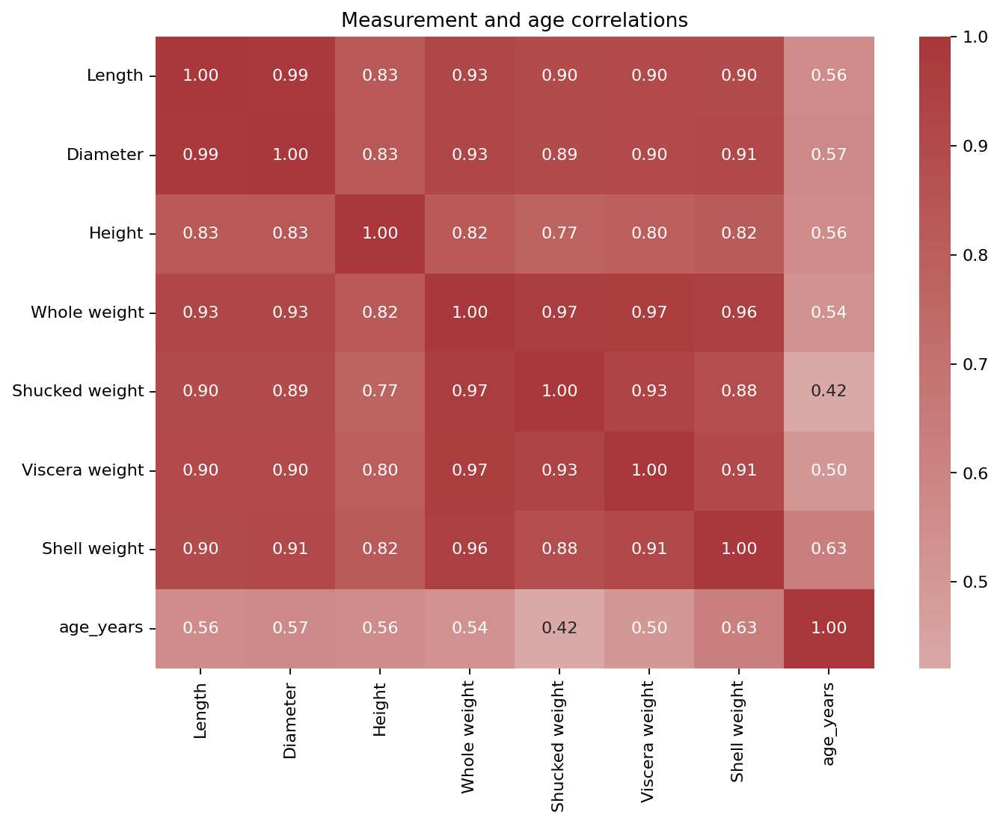
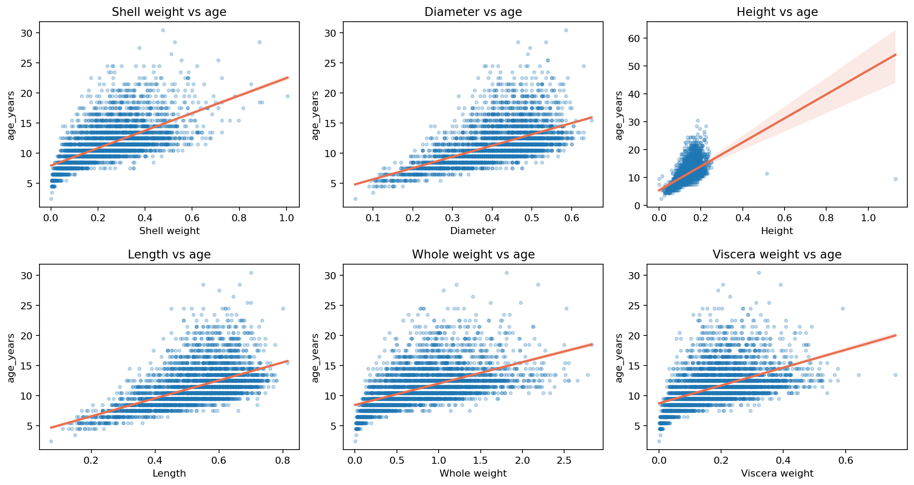
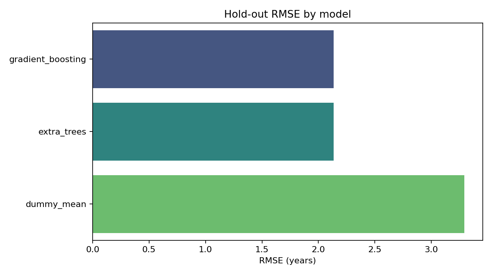
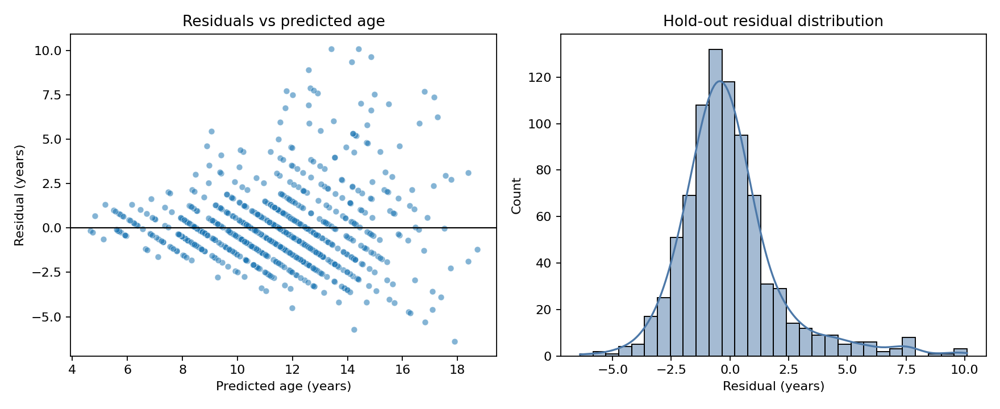
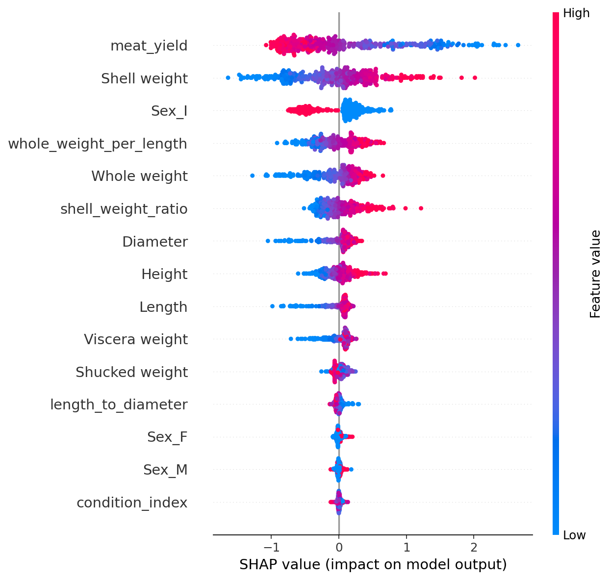
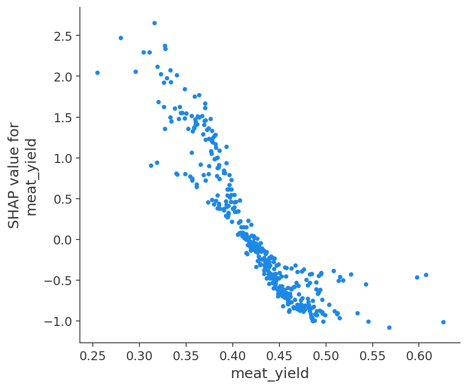

# Abalone age prediction

> **Research question**  Can an abalone’s age be estimated from physical measurements that are easier to collect than counting shell rings?
>
> **Best cross-validated model**  Extra Trees · **MAE 1.49 years** · **RMSE 2.14 years** · **R² 0.58**

This project uses the provided Abalone data to estimate age from sex, shell dimensions, and body and shell weights. The target is calculated as `Rings + 1.5` years. The workflow covers exploratory data analysis, leakage-safe model selection, model interpretation, scoring, and input drift monitoring.

<p align="center">
  <a href="#research-purpose">Purpose</a> ·
  <a href="#exploratory-data-analysis">EDA</a> ·
  <a href="#methodology">Methodology</a> ·
  <a href="#results">Results</a> ·
  <a href="#interpretation-with-shap">SHAP</a> ·
  <a href="#conclusion-and-limitations">Conclusion</a> ·
  <a href="#run-the-project">Run it</a>
</p>

## Contents

- [Research purpose](#research-purpose)
- [Data and exploratory analysis](#exploratory-data-analysis)
- [Methodology and rationale](#methodology)
- [Results and evaluation](#results)
- [Model interpretation with SHAP](#interpretation-with-shap)
- [Conclusion and limitations](#conclusion-and-limitations)
- [Run the project](#run-the-project)
- [Project structure and reports](#project-structure-and-reports)

## Research purpose

Abalone age is conventionally measured by cutting and staining the shell, then counting its rings under a microscope. That process is slow and destructive. This study tests whether routinely collected physical measurements can provide a useful estimate of age instead.

The work has four goals:

1. Understand the data, target, and measurement relationships before modelling.
2. Compare tuned regression models using validation that keeps the final test set separate.
3. Explain which inputs most affect predictions and in what direction.
4. Save a repeatable model and provide scripts for scoring and monitoring future batches.

## Exploratory data analysis

The data contains **4,177 abalones**, eight candidate inputs, and the `Rings` label. Age ranges from **2.5 to 30.5 years**, with a median of **10.5 years**. The categories are 1,528 males, 1,307 females, and 1,342 infants.

| EDA check | Finding | Why it matters |
|---|---:|---|
| Missing source values | 0 | The original measurements are complete. |
| Duplicate rows | 0 | No exact duplicate records were found. |
| Zero/non-positive measurements | 2 zero heights | These can create undefined ratios, so the pipeline imputes derived numeric values instead of dropping animals. |
| Strongest linear association with age | Shell weight, *r* = 0.628 | Heavier shells tend to be associated with older abalones, though correlation alone does not establish cause. |
| Age distribution | Right-skewed | A small number of older animals makes error measures in years useful alongside R². |

### Target distribution and cohort



The age groups are unevenly represented, and the older ages form a longer tail. This motivates reporting both MAE, which describes typical absolute error, and RMSE, which penalizes larger misses more heavily.



The infant category (`I`) represents a distinct cohort and should not be treated as a missing sex label. Sex is retained as a model input and one-hot encoded within the training pipeline.

### Relationships among measurements



Several size and weight measurements move together. Shell weight has the strongest simple linear correlation with age in this dataset, followed by diameter, height, and length. Since these inputs are correlated, the tree ensemble models can learn non-linear splits and combinations without requiring PCA or manual feature selection.



The scatterplots show that individual measurements relate to age, but with substantial spread: animals with similar dimensions can have different ages. That is one reason this remains an estimation problem rather than a direct measurement of age.

The full data summary and correlation values are available in [data_profile.md](reports/data_profile.md), [data_summary.csv](reports/data_summary.csv), and [age_correlations.csv](reports/age_correlations.csv).

## Methodology

### Target, split, and validation

- Convert rings to age with `age_years = Rings + 1.5`.
- Hold out 20% of rows as a final test set using `random_state=42`.
- On the remaining 80%, use shuffled 3-fold cross-validation and randomized hyperparameter search.
- Select the model with the lowest mean cross-validation RMSE. Report each tuned candidate's score on the untouched test set after tuning; test scores are not used to choose the winner.
- Keep all preprocessing inside the scikit-learn pipeline so imputation and category encoding are fit on each training fold only.

The saved search used three randomized parameter configurations per tuned model. This is a compact search rather than an exhaustive optimization, so its result is a useful baseline and can be expanded with `--iterations` for a longer search.

### Features and models

The model keeps the original size and weight measurements and adds interpretable ratios:

| Feature | Definition | Rationale |
|---|---|---|
| `length_to_diameter` | Length / Diameter | Describes shell proportions. |
| `whole_weight_per_length` | Whole weight / Length | Normalizes mass by a linear size measure. |
| `meat_yield` | Shucked weight / Whole weight | Describes the edible portion relative to total body mass. |
| `shell_weight_ratio` | Shell weight / Whole weight | Describes shell allocation relative to total mass. |
| `condition_index` | Whole weight / (Length × Diameter × Height) | A size-normalized body condition proxy. |

Numeric inputs are median-imputed and `Sex` is most-frequent-imputed then one-hot encoded inside the pipeline. The candidates are Extra Trees and Gradient Boosting regression models, with a mean-prediction dummy model as a baseline. No observations are removed as outliers before splitting; rare or extreme animals are part of the prediction task.

Tree ensembles were chosen because the measurements are correlated and age may depend on non-linear thresholds and interactions. A simple mean baseline shows whether the fitted features add useful predictive signal.

## Results

### Cross-validation and held-out test performance

All errors are measured in years. The selected model is the one with the lowest cross-validation RMSE; hold-out results are shown as the final generalization estimate.

| Model | CV RMSE (mean ± SD) | Test MAE | Test RMSE | Test R² |
|---|---:|---:|---:|---:|
| **Extra Trees (selected)** | **2.085 ± 0.074** | **1.490** | 2.136 | 0.579 |
| Gradient Boosting | 2.104 ± 0.077 | 1.504 | **2.134** | **0.579** |
| Dummy mean baseline | 3.209 ± 0.075 | 2.385 | 3.291 | -0.000 |



Extra Trees had the lowest cross-validation RMSE and was therefore selected before consulting the test metrics. Gradient Boosting's hold-out RMSE is lower by about **0.001 years**, a negligible difference on this split; the report retains Extra Trees because selection is based on cross-validation. Both tuned models substantially outperform the dummy baseline. Compared with that baseline, Extra Trees reduces test MAE by about **38%** and RMSE by about **35%**.

The selected model's test MAE of **1.49 years** means its predictions are typically about one and a half years from the ring-derived age. R² of **0.579** means it explains roughly 58% of test-set age variation. It is useful as an estimate, but it cannot replace ring counting where precise age is required.

### Residual diagnostics



Residuals are actual minus predicted age. A pattern away from zero can indicate systematic over- or under-prediction; the saved row-level test predictions allow further error analysis by age or cohort. The test residual bias is approximately **-0.032 years**, close to zero overall, although average bias can hide errors within particular age groups.

Detailed scores and selected parameters are in [model_comparison.csv](reports/model_comparison.csv); search trials are available for [Extra Trees](reports/hyperopt_trials_extra_trees.csv) and [Gradient Boosting](reports/hyperopt_trials_gradient_boosting.csv).

## Interpretation with SHAP

SHAP values describe how model inputs contribute to predictions. The global explanation below was calculated from a reproducible sample of 400 records. Mean absolute SHAP is measured in predicted years; larger values indicate greater average contribution magnitude, not causation.



| Rank | Feature | Mean absolute SHAP |
|---:|---|---:|
| 1 | `meat_yield` | 0.679 years |
| 2 | Shell weight | 0.497 years |
| 3 | Infant category (`Sex_I`) | 0.309 years |
| 4 | `whole_weight_per_length` | 0.263 years |
| 5 | Whole weight | 0.262 years |



Meat yield is the most influential feature by average absolute contribution in this fitted model, while shell weight is the strongest simple linear correlate with age in EDA. These are different questions: correlation measures a pairwise linear relationship; SHAP measures how the fitted model uses each feature, including non-linear effects and interactions. See [shap_explanation.md](reports/shap_explanation.md) and [shap_feature_importance.csv](reports/shap_feature_importance.csv) for the full explanation.

## Conclusion and limitations

On this split, measurements and engineered ratios provide substantially better age estimates than predicting the mean age for every abalone. Cross-validation selected Extra Trees, with a held-out MAE of about **1.49 years** and RMSE of **2.14 years**. The most influential model inputs include meat yield, shell weight, and the infant category.

The model cannot explain all age variation. The dataset does not include location, food availability, or weather, all of which may affect growth. Ring-derived age is itself an estimate, and the limited randomized search may not find the best possible model. The reported test score is from a single random split, so performance should be checked on new, representative data before operational use. SHAP importance describes model behavior and should not be interpreted causally.

## Run the project

Use Python 3.10 or later. Install the project and its dependencies, then run the stages below from the repository root:

```powershell
python -m pip install -e .

# EDA tables, profile, and figures
python scripts/profile_data.py

# Tune models, evaluate the winner, and save the model and reports
python scripts/train_compare.py --iterations 3

# Explain the trained tree model with SHAP
python scripts/explain_model.py --sample-size 400

# Score a CSV containing the eight raw measurement columns
python scripts/score_model.py --input abalone.csv --output submissions/abalone_predictions.csv

# Compare a batch with the training reference profile; Rings is optional
python scripts/monitor_data.py --input abalone.csv
```

For new scoring data, provide `Sex`, `Length`, `Diameter`, `Height`, `Whole weight`, `Shucked weight`, `Viscera weight`, and `Shell weight`. Include `Rings` only when you also want labelled-batch metrics.

The scorer writes predicted age and an approximate interval based on held-out residual spread. The monitor checks missingness, non-positive raw measurements, numeric population stability index (PSI), and category shifts; when labels are present it also reports regression metrics. A batch scored from the training data is useful for checking the scripts, but it is not an independent performance estimate.

## Project structure and reports

- [`notebooks/abalone_modeling_original.ipynb`](notebooks/abalone_modeling_original.ipynb) — original exploratory notebook.
- [`src/abalone/`](src/abalone/) — reusable feature, modelling, evaluation, and monitoring code.
- [`scripts/`](scripts/) — EDA, training, explanation, scoring, and monitoring entry points.
- [`models/`](models/) — selected model, metadata, and reference distributions.
- [`reports/figures/`](reports/figures/) — EDA, model comparison, residual, and SHAP figures embedded above.
- [`reports/monitoring/`](reports/monitoring/) — latest data and model monitoring report.
- [`submissions/abalone_predictions.csv`](submissions/abalone_predictions.csv) — example scored output.
